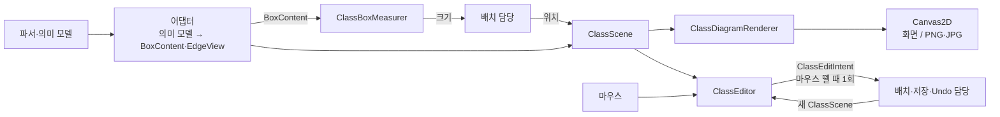

# 클래스 다이어그램 렌더링·편집 인터페이스

PR #1(`feat/diagram-model-seyun`)의 Gradle 빌드와 공통 타입(`ElementId`, `Style`, `StyleColor`) 위에 작성했습니다. 이 PR은 **클래스 다이어그램을 그리고 마우스로 편집하는 부분의 인터페이스**만 정의합니다. 그리기·스냅·클릭 판정 알고리즘은 팀원들과 접점을 맞춘 뒤 구현합니다.


## 데이터 흐름



편집기는 받은 장면을 직접 고치지 않고 편집 결과만 내보냅니다. 반영된 새 장면을 다시 받아서 그립니다.

## 타입

| 구분 | 타입 | 역할 |
| --- | --- | --- |
| 공통 후보 `uml.view` | `Point`, `Bounds` | 월드 좌표의 점과 사각형(double) |
| | `FontSpec`, `TextMetrics` | 글자 모양, 실제 글꼴 기준 측정 |
| | `Canvas2D` | 그리기 바탕. 화면과 이미지 내보내기가 각각 구현 |
| 데이터 | `BoxContent`, `MemberLine` | 박스 3칸에 들어갈 표시 문자열 |
| | `BoxMetrics` | 측정한 박스 크기와 칸별 높이 |
| | `ClassScene`, `BoxView`, `EdgeView` | 한 번 그릴 장면. ID 중복·없는 참조 검증 |
| | `LineStyle`, `EndMarker` | 실선/점선, 선 끝 모양 |
| 인터페이스 | `ClassBoxMeasurer` | 글자 → 박스 크기 |
| | `ClassDiagramRenderer` | 장면 그리기, 관계선 경로, 내보내기 경계 |
| | `ClassHitTester` | 클릭 지점 → 꺾임점 / 박스 / 선 / 빈 곳 |
| | `SnapPolicy` | 격자·정렬 스냅과 안내선 |
| | `ClassEditor` | press → drag → release를 편집 결과로 변환 |
| | `ClassEditIntent` | 편집 결과 5종: 박스 이동, 꺾임점 추가·이동·삭제, 색 변경 |
| 예시 | `ClassViewExamples` | 상속·연관·합성·자기 관계가 있는 예시 장면 |

## 규칙

- 좌표는 확대·스크롤과 무관한 월드 좌표이고 x는 오른쪽, y는 아래로 증가합니다. 박스는 왼쪽 위 기준입니다.
- 렌더러는 UML 관계 종류를 해석하지 않습니다. 어댑터가 `LineStyle`과 양 끝 `EndMarker`로 바꿔 넘깁니다.
- 관계선 양 끝은 렌더러가 박스 테두리에서 계산합니다. `waypoints`에는 중간 꺾임점만 넣습니다.
- 편집 결과는 마우스를 뗄 때 위치가 실제로 바뀐 경우에만 한 번 보냅니다. 편집 1건이 Undo 1단계입니다.
- 편집 결과의 좌표는 스냅이 적용된 절대 좌표입니다. 이동량이 아닙니다.
- 선택 표시(`selected`)는 화면 상태이며 저장·Undo 대상이 아닙니다.

어댑터가 참고할 관계별 모양입니다.

| 관계 | Mermaid | `LineStyle` | 끝 모양 |
| --- | --- | --- | --- |
| 상속 | `<\|--` | SOLID | 부모 쪽 HOLLOW_TRIANGLE |
| 구현 | `<\|..` | DASHED | 인터페이스 쪽 HOLLOW_TRIANGLE |
| 연관 | `-->` | SOLID | 화살표 쪽 OPEN_ARROW |
| 의존 | `..>` | DASHED | 화살표 쪽 OPEN_ARROW |
| 집합 | `o--` | SOLID | 전체 쪽 HOLLOW_DIAMOND |
| 합성 | `*--` | SOLID | 전체 쪽 FILLED_DIAMOND |

## 다른 작업과 맞춰볼 부분

| 대상 | 맞춘 것 | 결정 필요 |
| --- | --- | --- |
| PR #1 시퀀스 모델 | `ElementId`·`Style`·`StyleColor` 재사용, record + 생성자 검증, `check()`, 예시 데이터, JUnit 5 | `Violation`을 공통 패키지로 옮길지 |
| PR #1 `SequenceGeometry.Bounds` | 왼쪽 위 + 폭·높이 | int와 double 중 무엇으로 통일할지 |
| PR #2 시퀀스 배치 | 월드 좌표 규칙, 측정은 렌더러·위치는 배치 담당 | 패키지(`org.se2uml`)와 ID 타입(`String`) 통일 |
| 클래스 파서 | 렌더러는 파서 모델에 의존하지 않음 | 어댑터를 누가 만들지 |

## 팀에서 합의할 사항

1. `Violation`, `Bounds`를 공통 패키지로 합칠 것인가? 좌표는 double로 통일할 것인가?
2. `StyleColor`를 박스의 어디에 적용할 것인가? (선·글자 색 / 배경색)
3. 꺾임점과 박스 색은 어디에 저장하는가? 배치 데이터인가, Mermaid 코드인가?
4. 박스를 옮겼을 때 연결된 선의 꺾임점도 같이 옮길 것인가?
5. 어댑터(의미 모델 → `BoxContent`·`EdgeView`)는 누가 만드는가?
6. UI 프레임워크, 글꼴, 기본 글자 크기는 무엇인가? (현재 `Style.DEFAULT`는 16)

## 실행

```bash
./gradlew test        # Windows: .\gradlew.bat test
```

테스트는 입력 검증, 불변성, 편집 결과 종류만 확인합니다. 그리기·스냅 동작 검증은 아닙니다.
