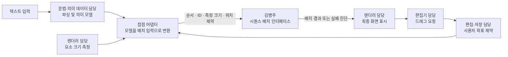
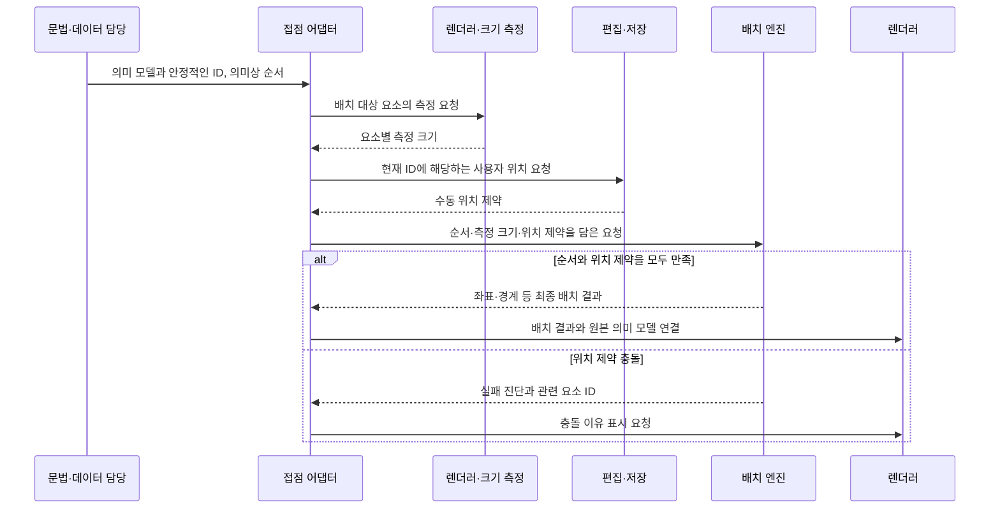

# dev 통합 시 인터페이스 의도를 함께 확인하는 방법

팀이 나뉘어 작업하므로 `dev` 통합에서는 타입이 연결되는지와 함께 **각 담당자가 입력·출력으로 어떤 의도를 표현했는지** 확인합니다. 아래 그림은 협의를 위한 접점 지도입니다. 실제 문법·의미 모델의 타입과 API는 해당 담당자가 정하며, 배치 팀이 대신 정의하지 않습니다.

## 책임과 데이터 연결

접점 어댑터의 담당자는 회의에서 정합니다. 이 그림의 이름은 역할 설명이며 팀원의 실제 모델 클래스 이름이 아닙니다. 배치 엔진은 문법을 파싱하거나 실행 순서를 변경하지 않습니다. 인터페이스와 실제 배치 엔진 구현은 구분합니다.

## 한 번의 배치 요청에서 전달하는 의도

현재 엔진 구현·측정·저장 어댑터는 미구현이므로 이 그림은 합의할 호출 흐름입니다. 인터페이스 타입에 대한 검증 통과가 실제 연결 동작의 완료를 뜻하지 않습니다.

## PR에 함께 적을 계약 설명

예를 들어 아래 숫자는 UML 문법과 독립적인 **배치 계약 검토용 가상 데이터**입니다. 실제 엔진의 실행 결과는 아닙니다. 모두 같은 월드 좌표 단위를 사용합니다.

| 입력 또는 변경 | 함께 설명할 기대 동작 |
| --- | --- |
| 가로 순서 `[p1, p2]`, 박스 폭 각각 80, 최소 간격 20 | p1의 오른쪽 끝과 p2의 왼쪽 사이에 최소 20 확보 |
| p1의 왼쪽 x=40 고정, p2의 왼쪽 x=220 고정 | 두 위치를 그대로 유지할 수 있음: `220 - (40 + 80) = 100` |
| p1의 왼쪽 x=180 고정, p2의 왼쪽 x=220 고정 | 간격을 만족하지 못하므로 오류; 순서를 바꾸거나 고정을 무시하면 안 됨 |
| 세로 순서 `[r1, r2]`, r1 위쪽 y=100·높이 20·행 간격 10, r2 위쪽 y=60 고정 | r2는 최소 y=130이어야 하므로 오류; 의미상 순서를 바꾸지 않음 |

정확한 수동 위치를 보존하려면 `PositionHint.pinned=true`를 사용합니다. `false`는 조정 가능한 선호 위치이며 조정 시 경고가 필요합니다. 이 구분을 양쪽 담당자가 같은 뜻으로 해석하는지 검토합니다.

| 항목 | 담당자가 설명할 내용 |
| --- | --- |
| 입력 | 호출자가 확정해서 전달하는 값과 그 의미 |
| 출력 | 다음 담당자가 사용할 값과 보장되는 조건 |
| 식별 | 같은 요소의 ID를 누가 유지하고 어떻게 연결하는지 |
| 순서 | 선언·실행 순서와 화면 좌표를 어떻게 구분하는지 |
| 좌표 | 단위, 원점, 기준점, 절대 위치와 오프셋의 구분 |
| 실패 | 충돌·없는 참조·지원하지 않는 기능의 반환 방식 |
| 책임 경계 | 이 인터페이스에서 계산하거나 변경하지 않는 값 |
| 예시 | 동일한 예시 입력과 기대 결과를 보여주는 데이터 또는 그림 |

## dev 병합 전 공동 확인

먼저 개인 작업을 `feat/diagram-model`에 모아 접점 계약을 검토합니다. `dev`로 통합할 때는 아래 시나리오를 같은 ID와 예시 데이터로 설명하고, 엔진 구현이 준비되면 실제 출력으로 확인합니다.

| 시나리오 | 시각적으로 확인할 의도 |
| --- | --- |
| 첫 표시 | 전달된 참여자·메시지 순서를 유지하며 자동 배치 |
| 참여자 가로 이동 | 허용 범위의 사용자 위치 적용, 메시지 연결 위치 갱신 |
| 메시지 세로 이동 | 의미상 실행 순서를 유지하면서 위치 제약 적용 |
| 순서와 충돌하는 이동 | 조용히 순서를 변경하지 않고 충돌을 설명 |
| 요소 추가·이름 변경 | ID 연결과 기존 수동 위치의 적용 여부 확인 |
| 저장 후 다시 열기 | 복원한 위치 제약을 새 배치 요청에 전달 |

계약 검토 단계에서는 입력·기대 출력 그림으로 확인하고, 실제 엔진이 없는 동작은 미검증으로 표시합니다. 실행 통합 단계에서는 배치 결과 그림과 실패 진단을 비교합니다. 특정 인터페이스가 맞지 않으면 그 담당자와 접점부터 수정한 뒤 병합합니다.

시퀀스 배치 인터페이스의 상세 범위는 [배치 계약 문서](SEQUENCE_LAYOUT_CONTRACT.md)를 참고합니다.
