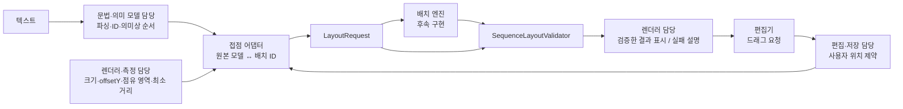
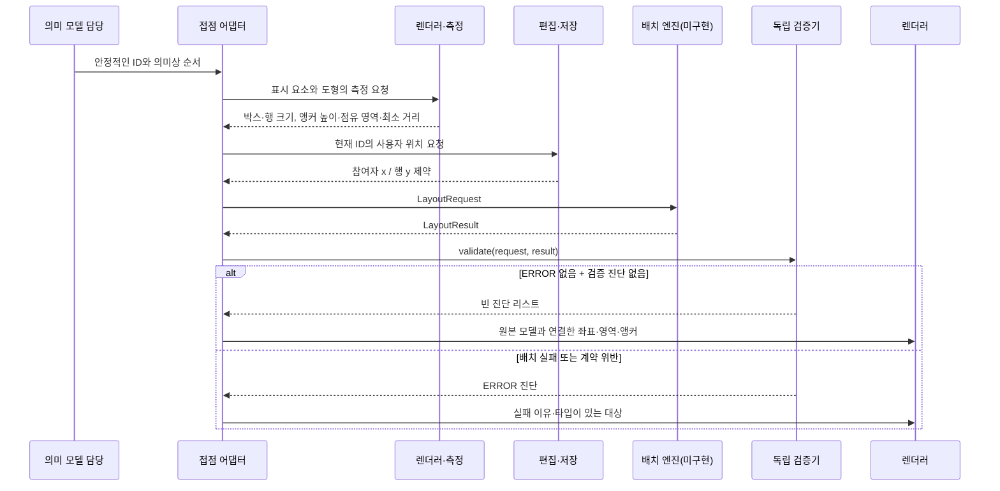

# dev 통합에서 배치 인터페이스의 의도를 확인하는 방법

팀이 나뉘어 작업하므로 타입 연결과 함께 **각 담당자가 어떤 의미를 전달했는지** 확인합니다. 문법·의미 모델 타입은 해당 담당자가 정의합니다. 배치 담당은 모델을 다시 정의하지 않고 측정 데이터와 위치 제약을 받습니다.

현재 Java 25의 배치 인터페이스·입출력 타입과 독립 검증기가 준비되었습니다. **실제 배치 엔진, 모델 어댑터, 렌더러·저장 연결은 미구현**입니다. 아래 그림은 향후 통합 흐름이며, 계약 검증과 실제 실행 통합을 구분합니다.

## 책임과 데이터 연결



어댑터 담당자는 회의에서 정합니다. 배치 엔진은 문법을 파싱하거나 실행 순서를 변경하지 않습니다. `LayoutRow`는 측정된 행이며 메시지 의미 모델이 아닙니다.

## 한 번의 요청에서 전달할 의도



인터페이스와 검증기가 준비됐다는 것은 이 전체 흐름이 작동한다는 뜻이 아닙니다. 현재는 같은 수동 기대 결과를 검증하고 각 담당자의 해석을 확인합니다. 실제 엔진 연결 시에는 같은 검증기에 실제 결과를 전달합니다.

## 코드로 확인하는 팀 접점

| 데이터 | 보내는 의도 | 받는 쪽의 확인 |
| --- | --- | --- |
| `participants` | 가로 순서와 박스 측정 크기 | 입력 순서 보존, 측정 크기 유지 |
| `rows` | 세로 순서와 최소 영역 크기 | 실행 순서를 배치 좌표로 재정의하지 않음 |
| `AnchorSpec` | 참여자 중심 x, 행 기준 `offsetY`, 좌우 점유 영역 | 결과 앵커와 점유 영역이 행 안에 포함됨 |
| `MinimumSpan` | 앵커 인덱스 두 개의 최소 절대 가로 거리 | 역순 인덱스도 거리 조건 유지 |
| `PositionHint` | 왼쪽 x 또는 위쪽 y, 고정/선호 구분 | 고정은 정확히, 선호 조정은 경고 |
| `LayoutResult` | ID별 영역, 입력 앵커 순서, 캔버스와 진단 | 요청과 결과를 함께 검증한 후 사용 |
| `Diagnostic.target` | `ElementRef(kind, id)` 또는 전체 진단 | 참여자·행의 같은 문자열 ID를 구분 |

예를 들어 `new AnchorSpec("p1", 15, 10, 30)`은 행 위쪽에서 15 아래의 p1 중심 연결점과 좌우 10·30의 점유 영역을 뜻합니다. `new MinimumSpan(0, 1, 140)`은 첫 두 앵커의 절대 가로 거리가 최소 140이어야 한다는 뜻입니다. 행의 측정 폭만 늘리는 것으로 이 거리 조건을 대체할 수 없습니다.

```java
// 이 요청/기대 결과 생성 전체 코드는 배치 계약 문서에 있습니다.
// 현재는 수동 기대 결과를 검증하고 실제 알고리즘을 실행하지 않습니다.
var violations = SequenceLayoutValidator.validate(request, expectedResult);
if (expectedResult.hasErrors() || !violations.isEmpty()) {
    // 진단으로 어댑터 입력이나 기대 결과의 불일치를 협의합니다.
} else {
    // 같은 ID를 사용해 의미 모델과 검증된 기대 좌표를 연결합니다.
}
```

[배치 계약 문서](SEQUENCE_LAYOUT_CONTRACT.md#실행-가능한-java-예시)에 Java 25에서 실행 가능한 요청·수동 결과·검증 예시가 있습니다. 실제 구현체가 제공되면 `expectedResult` 대신 `engine.layout(request)` 결과를 연결합니다.

## 수치와 충돌을 함께 설명하는 예시

아래 조건은 참여자 순서 `[p1, p2]`, 폭 각각 80, 가로 간격 20, 앵커 최소 거리 140, p2의 왼쪽 x=220 고정입니다. 참여자 중심은 각 왼쪽 x에 40을 더한 값입니다.

| 변경 | 계산 및 기대 정책 |
| --- | --- |
| p1 왼쪽 x=80 고정 | 박스 간격은 `220 - (80 + 80) = 60`, 중심 거리는 `260 - 120 = 140`: 유지 가능 |
| p1 왼쪽 x=180 선호 | 박스 간격과 최소 거리를 만족하도록 x=80 이하로 조정; `POSITION_ADJUSTED` WARNING |
| p1 왼쪽 x=180 고정 | 박스 간격과 중심 거리 조건 충돌: ERROR, 고정 무시나 순서 변경 금지 |
| r1 위쪽 y=100 고정·높이20·행 간격10, r2 위쪽 y=60 고정 | r2는 최소 y=130이어야 함: ERROR |
| 같은 참여자를 두 번 참조, 앵커 `offsetY`는 5와15 | 높이가 다른 두 앵커 표현 가능; x는 같은 참여자 중심 |
| 같은 참여자 두 앵커 사이 양의 `MinimumSpan` | 두 x가 같으므로 충족 불가능: ERROR 정책 필요 |

이 표는 기대 정책이고 실제 엔진 출력이 아닙니다. 엔진 구현 전에는 요청·수동 결과를 비교하여 조건을 설명합니다.

`SequenceLayoutValidator.EPSILON = 1e-6`은 크기·간격·앵커·최소 거리 등의 수치 비교에 사용하는 절대 오차입니다. **고정 좌표에는 적용하지 않습니다.** 고정 좌표는 수치가 정확히 같아야 하며 부호 있는 0은 동등합니다. 선호 좌표를 EPSILON보다 크게 조정하면 `POSITION_ADJUSTED` WARNING과 맞는 `ElementRef`가 필요합니다.

`hasErrors()`는 ERROR 진단 유무만 확인합니다. 검증기의 빈 진단 리스트까지 확인해야 정상 결과로 소비할 수 있습니다. 오류 결과에 일부 영역이 존재하더라도 정상 화면에 사용하지 않습니다. ERROR 결과는 검증기도 오류 상태로 반환합니다.

## PR과 dev 병합에서 함께 확인할 사항

개인 브랜치 내용을 `feat/diagram-model`에 모아 계약을 검토한 뒤 `dev`에서 다른 팀의 접점을 연결합니다. [HTML](sequence-layout-interface.html)에 입력·출력·코드·진단 대상을 시각화하고 다음 항목을 설명합니다.

| 항목 | 함께 확인할 설명 |
| --- | --- |
| ID | 원본 요소와 배치 ID의 연결, 이름 변경 시 동일성, 삭제된 위치 정리 |
| 측정 | 좌표 단위·폰트·크기 측정 책임, offsetY·점유 영역·최소 거리 산출 근거 |
| 순서 | 의미상 순서 변경과 단순 위치 편집의 구분 |
| 위치 | 정확한 고정·선호·자동 위치와 저장할 값의 구분 |
| 실패 | 잘못된 요청의 생성 예외, 유효한 요청의 배치 불가능, 잘못된 결과의 검증 진단 |
| 시각화 | 같은 입력·기대 영역·앵커·진단 대상 사용, 실제 엔진 결과인지 명확히 표시 |
| 구현 상태 | 계약 검증 완료와 모델·엔진·렌더러·저장 연결 완료 구분 |

현재 계약은 독립된 순서 행을 다룹니다. 동일 y를 공유하는 여러 행, 중첩 그룹·프레임·영역 제약, 활성 구간·생명선의 전체 구조는 표현하지 않습니다. 파서·렌더러·저장 기능도 이 인터페이스 구현 범위 밖입니다. 지원할 기능과 측정 계약 확장은 해당 담당자와 합의하고, 시각화에서 미지원·미구현 상태를 드러냅니다.
