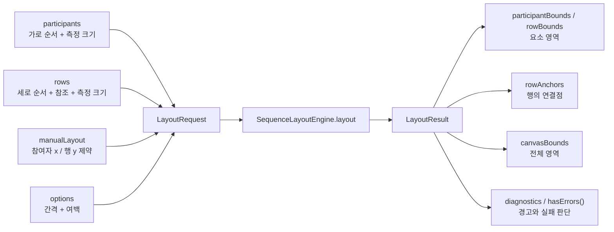

# 시퀀스 다이어그램 배치 알고리즘 인터페이스 — 김병주

작업 브랜치는 `feat/diagram-model`에서 분기한 `feat/diagram-model-kim-byeongju`이며, 병합 대상은 `feat/diagram-model`입니다. 이 작업은 **시퀀스 다이어그램 배치 알고리즘의 입출력 계약**만 정의합니다.

## 담당 범위와 팀 간 경계

김병주는 화면에 배치할 요소의 크기·순서·위치 제약을 받아 좌표를 계산하는 인터페이스를 담당합니다. 다른 팀원이 시퀀스 문법, 파서, 참여자·메시지 등의 의미 데이터 구조를 담당합니다. 이 브랜치에서는 그 의미 모델을 새로 정의하거나 변경하지 않습니다.

| 담당 | 책임 |
| --- | --- |
| 문법·데이터 구조 담당 | 문법 해석, 참여자와 메시지의 의미, 실행 순서, ID 관리 |
| 모델→배치 어댑터 담당 | 의미 모델을 배치 입력으로 변환하고 같은 요소의 ID 연결 |
| 배치 인터페이스 담당 | 배치 입력·결과·좌표 정책·실패 조건 정의 |
| 배치 엔진 구현 담당 | 인터페이스에 따라 실제 좌표 계산 |
| 렌더러 담당 | 텍스트 크기 측정, 계산된 좌표로 표시 |
| 편집·저장 담당 | 드래그 제약 적용, 사용자 위치 저장·복원 |

배치 입력은 의미 모델 자체가 아닙니다. 배치에 필요한 식별자·측정 크기·가로 순서·세로 순서만 전달하는 어댑터용 데이터입니다. 이 데이터의 이름이나 구조가 다른 팀원의 모델을 강제하지 않습니다. 어댑터의 구체적인 구현 담당은 팀에서 합의해야 합니다.

## 조사 근거와 개발 기준

[배치 알고리즘 조사 노트](https://app.notion.com/p/2-3ebc84b2acec813f9cb5e47eef7760eb)는 지정 Mermaid 커밋의 소스 코드를 조사한 자료입니다. 브라우저에서의 실측 결과로 해석하지 않습니다. 조사에서 확인한 시퀀스 배치의 흐름인 **참여자 가로 배치 후 메시지 세로 누적 배치**를 계약의 방향으로 삼습니다. 자동 배치와 사용자 지정 좌표 보존은 별도 정책으로 다룹니다.

Java 기준은 **Java 25**입니다. [Oracle 공식 다운로드 안내](https://www.oracle.com/java/technologies/downloads/)에서 Java 25를 LTS로 안내합니다. 프로젝트는 Java 25를 안정 버전 기준으로 사용하고 preview 기능은 사용하지 않습니다.

## Java 인터페이스

[HTML 설명 화면](sequence-layout-interface.html)에서 책임 경계, 입력 타입, 좌표 제약과 결과 예시를 함께 확인할 수 있습니다. 화면의 계산은 계약 설명용이며 실제 Java 엔진 구현이 아닙니다.

실제 코드 발췌, 선택 이유·대안, 검증된 레퍼런스와 팀 합의가 필요한 정책은 [코드와 설계 근거](INTERFACE_DESIGN_RATIONALE.md)에 정리했습니다.

계약 파일은 [SequenceLayoutEngine.java](../src/main/java/org/se2uml/layout/SequenceLayoutEngine.java)입니다. 진입점은 `SequenceLayoutEngine.layout(LayoutRequest)`이며, `LayoutResult`를 반환합니다. 외부 문법·의미 모델 클래스에는 의존하지 않습니다.

| 타입 | 배치 관점의 역할 |
| --- | --- |
| `ParticipantBox` | 가로 배치할 박스의 ID와 측정 크기 |
| `LayoutRow` | 세로 배치할 행의 ID, 연결할 참여자 ID, 측정 크기 |
| `LayoutRequest` | 순서가 확정된 박스·행, 사용자 위치, 배치 옵션 |
| `ManualLayout` | 참여자 x와 행 y에 대한 위치 제약 |
| `PositionHint` | 요청 좌표와 `pinned` 고정 여부 |
| `LayoutOptions` | 참여자·행·헤더 간격과 외곽 여백 |
| `LayoutResult` | 박스·행 경계, 행 연결점, 전체 경계, 진단 |

`LayoutRow`는 메시지 의미 모델이 아닙니다. 호출자가 메시지 등을 화면의 행으로 변환해 전달하며, 자기 호출처럼 같은 참여자가 여러 번 연결되는 경우도 어댑터가 표현합니다. 메시지 종류나 문법을 배치 엔진이 결정하지 않습니다.

### 입력과 출력의 연결



### 필드별 의미

| 타입 | 필드 | 전달하려는 의미 |
| --- | --- | --- |
| `ParticipantBox` | `id`, `width`, `height` | 가로 배치할 박스의 식별자와 측정 크기 |
| `LayoutRow` | `id`, `participantIds`, `width`, `height` | 행 식별자, 순서 있는 참여자 참조, 필요한 측정 크기 |
| `ManualLayout` | `participantX`, `rowY` | ID별 참여자 왼쪽 x와 행 위쪽 y 제약 |
| `PositionHint` | `coordinate`, `pinned` | 요청 좌표와 정확히 고정할지 여부 |
| `LayoutOptions` | `participantGap` | 인접 참여자 박스 사이 최소 가로 간격 |
| `LayoutOptions` | `rowGap` | 인접 행 사이 최소 세로 간격 |
| `LayoutOptions` | `headerGap` | 가장 아래까지 내려온 참여자 박스와 첫 행 사이 최소 간격 |
| `LayoutOptions` | `margin` | 전체 콘텐츠 주변 여백 |
| `Bounds` | `x`, `y`, `width`, `height` | 왼쪽 위 좌표와 영역 크기 |
| `Point` | `x`, `y` | 하나의 연결점 좌표 |
| `Diagnostic` | `severity`, `code`, `message`, `elementId` | 경고·오류 수준, 진단 코드, 설명, 관련 ID |

`Diagnostic.elementId`가 null이면 다이어그램 전체 진단입니다. `code`는 문자열이며 표준 코드 목록은 아직 확정하지 않았습니다. 입력 리스트 순서는 보존하지만 결과 Map의 반복 순서는 보장하지 않습니다. 호출자는 입력 순서와 ID 조회를 함께 사용합니다.

## 배치 계약의 기본 규칙

- 좌표는 확대·스크롤과 독립적인 다이어그램 좌표이며 x는 오른쪽, y는 아래로 증가합니다.
- 텍스트 크기는 렌더러가 측정해서 전달합니다. 배치 엔진은 폰트나 문법을 직접 해석하지 않습니다.
- 참여자 가로 순서와 메시지 세로 순서는 호출자가 전달합니다. 배치 엔진은 의미상 순서를 재정의하지 않습니다.
- 사용자 위치가 없는 요소는 자동 배치 대상으로 처리합니다.
- 사용자 위치는 자동 배치 결과에 더하는 오프셋이 아니라 지정 위치 제약으로 취급합니다.
- `pinned=true`는 정확한 좌표를 보존해야 합니다. 순서·최소 간격을 만족시킬 수 없으면 `ERROR` 진단을 반환합니다.
- `pinned=false`는 선호 좌표입니다. 순서·최소 간격을 만족하기 위해 이동할 수 있으나, 조정하면 반드시 `WARNING` 진단을 반환합니다.
- 좌표 계산 결과와 저장할 사용자 위치는 구분합니다. 계산된 모든 좌표를 자동으로 수동 위치로 승격하지 않습니다.

## 좌표 이동과 순서 보존

시퀀스 다이어그램의 세로 위치에는 실행 순서가 드러납니다. 드래그로 메시지를 이전 메시지 위에 놓는 경우, 단순 배치 변경과 의미상 순서 변경을 구분해야 합니다. 이 인터페이스는 호출자가 제공한 순서를 보존하며, 순서 변경 기능은 의미 모델 담당과 편집기 담당이 결정합니다.

참여자 이동도 전달된 가로 순서를 보존하는 범위에서 처리합니다. 순서를 바꾸는 편집을 지원하려면 호출자가 먼저 새로운 순서를 입력에 반영해야 합니다. 좌표는 참여자 박스의 왼쪽 x와 행의 위쪽 y입니다. 정확한 위치 유지가 필요한 드래그 결과는 `pinned=true`로 전달합니다.

고정 위치가 충돌하면 `LayoutResult.hasErrors()`가 참인 결과를 반환합니다. 이때 결과 좌표는 일부만 존재할 수 있으며, 렌더러는 정상 배치로 사용하면 안 됩니다. 고정하지 않은 위치를 조정한 경우에는 `WARNING`을 표시합니다. 전체 자동 배치로 복귀하려면 `ManualLayout.empty()`를 전달합니다.

성공 결과의 `participantBounds`와 `rowBounds`는 입력 ID마다 하나의 경계를 포함합니다. `rowAnchors`의 순서와 개수는 행의 참여자 참조와 같으며, 중복 참조도 유지합니다. 연결점의 x는 참여자 박스 중심, y는 해당 행의 경계 안에서 엔진이 정합니다. 연결점에 UML 의미를 부여하는 일은 렌더러·어댑터의 책임입니다.

같은 요소의 좌표를 다시 적용하려면 ID가 유지되어야 합니다. 이름 변경·텍스트 재입력 시 동일성을 판단하는 방법은 파서와 모델 담당의 책임이며, 배치 엔진은 이름으로 ID를 추정하지 않습니다. 삭제한 요소의 위치 정리도 호출자가 담당합니다.

## HTML 화면과 같은 입력·출력 예시

아래는 계약 설명용 예시이며 실제 Java 엔진 실행 결과가 아닙니다. Java 25에서 사용할 수 있는 타입 표기를 사용합니다. JSON serializer나 다른 팀원의 문법·의미 모델을 정의하지 않습니다.

### 기본 요청

```java
import java.util.List;
import java.util.Map;
import org.se2uml.layout.SequenceLayoutEngine.*;

var request = new LayoutRequest(
    List.of(
        new ParticipantBox("p1", 80, 40),
        new ParticipantBox("p2", 80, 40)
    ),
    List.of(
        new LayoutRow("r1", List.of("p1", "p2"), 220, 30),
        new LayoutRow("r2", List.of("p2", "p1"), 220, 30)
    ),
    new ManualLayout(
        Map.of("p2", new PositionHint(220, true)),
        Map.of()
    ),
    new LayoutOptions(20, 40, 40, 20)
);
```

이 예시에서는 p2의 왼쪽을 x=220에 고정하고, p1과 각 행에는 수동 좌표를 지정하지 않습니다.

### 기본 요청에 대한 기대 결과의 한 가지 예

| 출력 필드 | ID | 기대 값 |
| --- | --- | --- |
| `participantBounds` | `p1` | `Bounds(40, 20, 80, 40)` |
| `participantBounds` | `p2` | `Bounds(220, 20, 80, 40)` |
| `rowBounds` | `r1` | `Bounds(70, 100, 220, 30)` |
| `rowBounds` | `r2` | `Bounds(70, 170, 220, 30)` |
| `rowAnchors` | `r1` | `[Point(80, 115), Point(260, 115)]` |
| `rowAnchors` | `r2` | `[Point(260, 185), Point(80, 185)]` |
| `canvasBounds` | 전체 | `Bounds(20, 0, 300, 220)` |
| `diagnostics` | 전체 | 빈 리스트, `hasErrors() == false` |

자동 배치의 유일한 정답 좌표를 정한 것은 아닙니다. 이 값들은 계약의 순서·측정 크기·간격·여백 조건을 만족하는 예시입니다. `r2`의 참조 순서가 `[p2, p1]`이므로 연결점도 그 순서를 유지합니다.

### 네 가지 좌표 요청 비교

공통 조건은 p2의 왼쪽 x=220 고정, p1의 폭=80, `participantGap=20`입니다. 따라서 p1의 왼쪽 x는 최대 120까지 두면 최소 간격을 만족합니다.

| HTML 모드 | p1에 전달하는 제약 | 기대 처리 | 진단 |
| --- | --- | --- | --- |
| 자동 배치 | p1 항목 없음 | 예시에서는 x=40으로 배치 | 없음 |
| 고정 위치 | `PositionHint(80, true)` | x=80을 정확히 유지 | 없음 |
| 선호 위치 | `PositionHint(180, false)` | 예시에서는 x=120으로 조정 | `WARNING` |
| 충돌 예시 | `PositionHint(180, true)` | p2 고정 위치와 함께 간격을 만족할 수 없음 | `ERROR` |

고정 충돌에서는 입력은 유효하지만 위치 제약을 동시에 만족할 수 없습니다. 엔진은 오류 진단을 반환해야 하며, HTML은 정상 출력 영역을 비우고 충돌하는 **요청 위치**를 따로 표시합니다. 입력 ID·크기·참조가 잘못된 경우에는 요청 생성 시 예외가 발생하므로 이 상황과 구분합니다.

### 렌더러가 결과를 받는 흐름

```java
// engine은 팀에서 구현·연결할 SequenceLayoutEngine입니다.
var result = engine.layout(request);
if (result.hasErrors()) {
    // diagnostics를 설명하고 기존의 유효한 화면을 유지하거나 재요청합니다.
    // 오류 결과의 좌표를 정상 배치로 사용하지 않습니다.
} else {
    // 입력 순서대로 ID를 조회해 participantBounds / rowBounds를 표시합니다.
    // rowAnchors를 원본 의미 모델과 연결해 선·화살표를 그립니다.
    // WARNING 진단이 있으면 선호 좌표 조정 사실을 사용자에게 알립니다.
}
```

배치 결과를 화면에 그리는 동작과 사용자 위치를 저장하는 동작은 호출자의 책임입니다. 배치 인터페이스는 입력을 변경하거나 직접 저장하지 않습니다.

## 구현 상태와 후속 작업

현재 산출물은 Java 인터페이스와 배치 전용 입출력 타입, 계약 검증입니다. 실제 자동 배치 알고리즘, 시퀀스 문법·의미 모델, 렌더링, 드래그 UI, 파일 저장·재읽기는 구현 완료 범위에 포함하지 않습니다.

팀 합의 후 모델 담당의 데이터에서 배치 입력으로 변환하는 어댑터, 실제 엔진, 렌더러·편집기 연결을 진행합니다. 저장 시스템은 유효한 사용자 위치를 ID와 함께 보관하고 다음 배치 요청에 전달해야 합니다.

Java 25 환경에서 저장소 루트에서 계약 검증을 실행합니다.

```bash
bash scripts/check-model.sh
```

이 검증은 계약 타입의 입력 검증과 불변성을 확인하며, 실제 자동 배치·저장·렌더링이 작동한다는 검증은 아닙니다.

팀별 인터페이스를 `dev`에서 연결하는 흐름과 역할은 [인터페이스 통합 설명](INTERFACE_INTEGRATION.md)을 참고합니다. 통합 예시는 계약을 이해하기 위한 배치 데이터 예시이며, 다른 팀의 시퀀스 문법·의미 모델을 정의하지 않습니다.

## 팀에서 합의할 사항

1. 참여자·메시지와 배치 요소 ID를 어떻게 연결하고 유지할 것인가?
2. 참여자 이동으로 순서를 바꾸는 동작을 지원할 것인가?
3. 메시지 이동은 간격 조절만 허용할 것인가, 의미상 순서 변경도 지원할 것인가?
4. 반복·분기·활성 구간 등 추가 요소를 언제 배치 계약에 확장할 것인가?
5. 실제 렌더러의 측정 단위와 최소 간격 기본값은 무엇인가?
