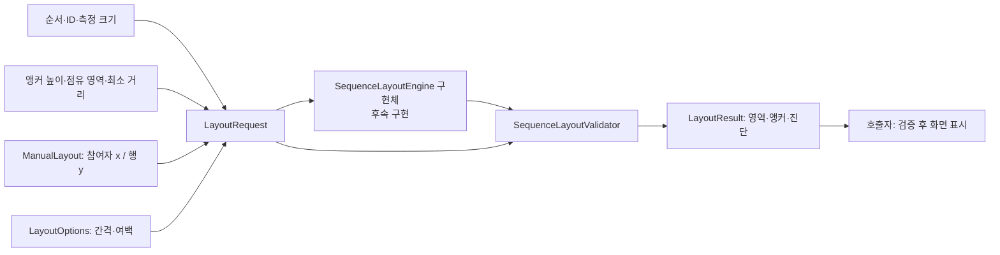

# 시퀀스 배치 인터페이스 계약 — 김병주

개인 브랜치 `feat/diagram-model-kim-byeongju`는 `feat/diagram-model`에서 분기했습니다. 먼저 모델 브랜치에서 팀 접점을 검토하고 `dev`에 통합합니다. 담당 범위는 **측정된 요소와 위치 제약을 받아 좌표를 계산하는 배치 인터페이스 계약과 독립 검증기**입니다. Java 25를 사용하며 preview 기능은 사용하지 않습니다.

## 담당 범위

| 담당 | 전달하거나 구현하는 내용 |
| --- | --- |
| 문법·의미 모델 | 문법, 참여자·메시지 의미, 안정적인 ID, 의미상 순서 |
| 모델→배치 어댑터 | 의미 모델을 배치 요청으로 변환, 원본 요소와 배치 ID 연결 |
| 렌더러·측정 | 텍스트와 도형 크기, 앵커 높이·점유 영역·필요 거리 측정 |
| 배치 담당 | 인터페이스, 제약 계산, 결과 검증, 충돌 진단 |
| 편집·저장 | 드래그 제약 적용과 사용자 좌표 저장·복원 |

`LayoutRow`는 메시지 문법이나 의미 모델이 아닙니다. 다른 팀이 정의한 모델을 받아 배치에 필요한 측정 데이터로 변환합니다. 어댑터의 구체적인 담당자는 팀에서 합의합니다.

[조사 노트](https://app.notion.com/p/2-3ebc84b2acec813f9cb5e47eef7760eb)의 참여자 가로 배치와 행 세로 배치 흐름을 참고했습니다. 사용자 좌표 보존·실패 정책·팀 접점은 이 프로젝트의 설계입니다. 도구와의 비교 및 출처는 [설계 근거](INTERFACE_DESIGN_RATIONALE.md), 발표 화면은 [HTML](sequence-layout-interface.html)에서 확인합니다. HTML의 브라우저 시연과 실제 Java 실행은 구분합니다.

## 실제 코드와 입출력

- [SequenceLayoutEngine.java](../src/main/java/org/se2uml/layout/SequenceLayoutEngine.java): 계약과 불변 입출력 타입
- [SequenceLayoutValidator.java](../src/main/java/org/se2uml/layout/SequenceLayoutValidator.java): 요청과 결과를 비교하는 독립 검증기



| 타입 | 필드와 의미 |
| --- | --- |
| `ParticipantBox` | `id`, `width`, `height`: 입력 순서대로 가로 배치할 박스 |
| `AnchorSpec` | `participantId`, `offsetY`, `leftExtent`, `rightExtent`: 참여자 중심을 기준으로 한 연결점과 가로 점유 영역 |
| `MinimumSpan` | `firstAnchorIndex`, `secondAnchorIndex`, `minDistance`: 같은 행의 두 앵커 사이 최소 **절대 가로 거리** |
| `LayoutRow` | `id`, `anchors`, `width`, `height`, `minimumSpans`: 순서대로 세로 배치할 측정 행 |
| `LayoutRequest` | `participants`, `rows`, `manualLayout`, `options` |
| `ManualLayout` | `participantX`, `rowY`: ID별 참여자 왼쪽 x와 행 위쪽 y 제약 |
| `PositionHint` | `coordinate`, `pinned`: 선호 위치 또는 정확히 고정할 위치 |
| `LayoutOptions` | `participantGap`, `rowGap`, `headerGap`, `margin`: 최소 간격과 콘텐츠 외곽 여백 |
| `LayoutResult` | `participantBounds`, `rowBounds`, `rowAnchors`, `canvasBounds`, `diagnostics` |
| `ElementRef` | `kind`, `id`: `PARTICIPANT` 또는 `ROW`로 구분한 진단 대상 |
| `Diagnostic` | `severity`, `code`, `message`, `target`: 경고·오류와 대상; `target=null`은 전체 진단 |

참여자와 행은 같은 문자열 ID를 쓸 수 있습니다. 따라서 `ElementRef(PARTICIPANT, "x")`와 `ElementRef(ROW, "x")`는 서로 다른 대상입니다. 결과 Map의 반복 순서는 계약에 포함하지 않으며 입력 리스트 순서와 ID 조회를 사용합니다.

## 측정 데이터가 전달하는 의도

`AnchorSpec("p1", 15, 10, 30)`은 p1 박스 중심 x에 연결점을 놓고, 행 위쪽 y에서 15 아래에 배치하며, 중심 왼쪽 10·오른쪽 30만큼 공간을 확보한다는 뜻입니다. 좌표는 다이어그램 좌표 단위이며 확대·스크롤과 독립적입니다.

- 앵커 x = 참여자 왼쪽 x + 폭 / 2
- 앵커 y = 행 위쪽 y + `offsetY`
- 행 영역은 `[앵커 x - leftExtent, 앵커 x + rightExtent]`를 모두 포함합니다.
- 행 `width`와 `height`는 최소 영역 크기입니다. `width`만으로 참여자 간 거리를 강제하지 않습니다.
- 두 참여자 중심 사이 공간이 필요하면 `MinimumSpan`으로 전달합니다. 앵커 인덱스가 역순이어도 절대 거리로 해석합니다.
- 같은 참여자를 반복 참조할 수 있고 각 앵커의 높이·점유 영역은 다를 수 있습니다. 같은 참여자 중심 사이에 양의 최소 가로 거리를 요청하면 배치가 불가능합니다.

앵커 높이는 0 이상 행 높이 이하여야 합니다. 폭·높이는 양수이고, 간격·점유 영역·최소 거리는 0 이상입니다. 좌표는 음수를 허용하지만 모든 수치는 유한해야 합니다. 중복 ID, 없는 참조, 범위를 벗어난 앵커 인덱스는 요청 생성 시 `IllegalArgumentException`으로 거부합니다. 생성된 입출력 컬렉션은 불변 스냅샷입니다.

## 좌표 보존과 성공 판단

`pinned=true`인 참여자 x·행 y는 정확히 유지합니다. 검증기의 `EPSILON = 1e-6`은 크기·간격·앵커 등 계산 결과 비교에 사용하는 절대 허용 오차이며 **고정 좌표에는 적용하지 않습니다**. 고정 좌표는 Java 수치 동등 비교를 사용하고 부호 있는 0은 같은 좌표로 봅니다.

`pinned=false`는 조정 가능한 선호 위치입니다. 조정량이 `EPSILON`보다 크면 `POSITION_ADJUSTED` WARNING과 해당 `ElementRef`가 필요합니다. 수동 위치가 없으면 자동 배치하며 `ManualLayout.empty()`로 자동 배치를 요청합니다. 계산된 좌표 전체를 자동으로 사용자 고정 위치로 저장하지 않습니다.

성공 결과는 입력과 정확히 같은 참여자·행·앵커 Map 키를 가지며, 행마다 앵커 개수와 순서가 입력과 같습니다. 측정 크기, 최소 간격, 앵커 점유 영역, 최소 거리, 캔버스 여백도 만족해야 합니다.

`hasErrors()`는 진단 수준만 확인합니다. 외부 구현체 결과를 소비할 때에는 `SequenceLayoutValidator.validate(request, result)`도 확인합니다. 반환 리스트가 비어 있어야 정상 배치입니다. ERROR 결과는 원래 ERROR 진단을 반환하므로 검증 성공으로 취급되지 않습니다. 인터페이스는 오류 시 부분 영역을 허용합니다. 실제 엔진 구현은 아직 없으며, 오류 영역을 정상 배치로 소비해서는 안 됩니다.

| 계약 진단 | 의미 |
| --- | --- |
| `POSITION_ADJUSTED` / WARNING | 선호 좌표를 EPSILON보다 크게 조정함; 타입이 있는 대상 전달 |
| 검증기 ERROR 코드 | ID·크기·간격·앵커·거리·고정 좌표·진단 대상·캔버스 계약 위반 |
| 구현체 ERROR 진단 | 배치 불가능한 제약; 구현체가 적절한 코드와 대상 전달 |

검증기는 `PARTICIPANT_IDS`, `ROW_IDS`, `ANCHOR_IDS`, `PARTICIPANT_SIZE`, `ROW_SIZE`, `PARTICIPANT_SPACING`, `ROW_SPACING`, `HEADER_GAP`, `ANCHOR_COUNT`, `ANCHOR_X`, `ANCHOR_Y`, `ANCHOR_EXTENTS`, `MINIMUM_SPAN`, `PIN_MOVED`, `PREFERRED_WARNING_MISSING`, `CANVAS_MARGIN`, `DIAGNOSTIC_TARGET`으로 위반 종류를 구분합니다. ERROR 진단 코드는 모든 UML 도구의 표준이 아니라 이 검증기 계약입니다.

## 실행 가능한 Java 예시

다음 코드를 `LayoutExample.java`로 저장합니다. **수동으로 작성한 기대 결과가 계약에 맞는지 확인하는 예시**입니다. 좌표 계산 알고리즘을 실행하는 코드가 아닙니다.

```java
import java.util.List;
import java.util.Map;
import org.se2uml.layout.SequenceLayoutValidator;
import org.se2uml.layout.SequenceLayoutEngine.*;

public class LayoutExample {
    public static void main(String[] args) {
        var request = new LayoutRequest(
            List.of(new ParticipantBox("p1", 80, 40),
                    new ParticipantBox("p2", 80, 40)),
            List.of(
                new LayoutRow("r1", List.of(
                    new AnchorSpec("p1", 15, 10, 10),
                    new AnchorSpec("p2", 15, 10, 10)),
                    220, 30, List.of(new MinimumSpan(0, 1, 140))),
                new LayoutRow("r2", List.of(
                    new AnchorSpec("p2", 15, 10, 10),
                    new AnchorSpec("p1", 15, 10, 10)),
                    220, 30, List.of(new MinimumSpan(0, 1, 140)))),
            new ManualLayout(Map.of("p2", new PositionHint(220, true)), Map.of()),
            new LayoutOptions(20, 40, 40, 20));

        // 팀이 검토할 수동 기대 결과. 실제 엔진은 아직 구현하지 않았습니다.
        var result = new LayoutResult(
            Map.of("p1", new Bounds(20, 20, 80, 40),
                   "p2", new Bounds(220, 20, 80, 40)),
            Map.of("r1", new Bounds(50, 100, 220, 30),
                   "r2", new Bounds(50, 170, 220, 30)),
            Map.of("r1", List.of(new Point(60, 115), new Point(260, 115)),
                   "r2", List.of(new Point(260, 185), new Point(60, 185))),
            new Bounds(0, 0, 320, 220), List.of());
        var violations = SequenceLayoutValidator.validate(request, result);
        if (result.hasErrors() || !violations.isEmpty()) {
            System.out.println("Layout failed: " + violations);
            return; // 오류 영역을 정상 화면으로 사용하지 않습니다.
        }
        for (var participant : request.participants()) {
            System.out.println(participant.id() + " "
                    + result.participantBounds().get(participant.id()));
        }
        for (var row : request.rows()) {
            System.out.println(row.id() + " " + result.rowBounds().get(row.id())
                    + " anchors=" + result.rowAnchors().get(row.id()));
        }
        System.out.println("canvas=" + result.canvasBounds());
        result.diagnostics().forEach(System.out::println);
    }
}
```

저장소 루트에서 Java 25의 `javac`·`java`로 실행합니다. 예시 클래스와 컴파일 출력은 임시 경로에 두면 됩니다.

```bash
javac --release 25 -d /tmp/se2-layout-example src/main/java/org/se2uml/layout/*.java LayoutExample.java
java -cp /tmp/se2-layout-example LayoutExample
```

| 수동 기대 결과: 검증 통과 | 값 |
| --- | --- |
| p1 | `Bounds(20, 20, 80, 40)` |
| p2 | `Bounds(220, 20, 80, 40)` |
| r1 | `Bounds(50, 100, 220, 30)`; 앵커 `(60,115)`, `(260,115)` |
| r2 | `Bounds(50, 170, 220, 30)`; 앵커 `(260,185)`, `(60,185)` |
| canvas | `Bounds(0, 0, 320, 220)` |

이 요청에서 p1의 선호 x=180을 지정하면 x=80 이하로 조정하고 WARNING을 반환해야 합니다. p1의 고정 x=180은 p2의 고정 x=220 및 최소 간격과 충돌하므로 ERROR를 반환해야 합니다. p1의 고정 x=80은 유지 가능한 요청입니다. 이는 기대 정책이며 실제 알고리즘 결과가 아닙니다. `r2`의 앵커 순서는 입력처럼 역방향으로 유지합니다.

## 구현 상태와 확장 경계

현재 구현한 것은 Java 인터페이스·입출력 타입과 독립 검증기입니다. **실제 좌표 계산 엔진은 미구현**입니다. 검증기는 입력과 결과를 비교할 뿐, 올바른 결과를 계산하거나 충돌을 해결하지 않습니다. `hasErrors()`도 영역을 검증하는 메서드가 아닙니다.

후속 엔진은 가로·세로 순서, 측정 크기·점유 영역, 최소 거리, 정확한 고정 좌표, 선호 조정 진단을 모두 만족해야 합니다. 특정 자동 좌표나 최적화 알고리즘을 계약이 강제하지 않습니다. 파서·의미 모델·텍스트 측정·렌더러·드래그 UI·저장 기능은 별도 작업입니다.

현재 계약은 순서가 있는 참여자 박스와 독립 행을 다룹니다. 여러 행을 같은 y에 묶기, 중첩 그룹·프레임·영역 제약, 활성 구간이나 생명선의 전체 구조는 표현하지 않습니다. 필요한 의미는 모델 담당과 합의하여 별도 측정 계약으로 확장합니다. 같은 참여자 앵커의 양의 최소 가로 거리는 충족 불가능합니다.

실제 구현체가 준비되면 아래 접점으로 연결합니다.

```java
// engine은 팀이 구현할 SequenceLayoutEngine 인스턴스입니다.
var result = engine.layout(request);
var violations = SequenceLayoutValidator.validate(request, result);
if (!result.hasErrors() && violations.isEmpty()) {
    // 입력 순서대로 ID를 조회하여 렌더러에 전달합니다.
    // 진단의 WARNING은 위치 조정 사실을 알리는 데 사용합니다.
} else {
    // 기존 유효한 화면을 유지하거나 재요청하고 충돌·계약 위반을 설명합니다.
}
```

## 검증과 통합

```bash
bash scripts/check-model.sh
```

계약 검사는 입력 검증·불변성 및 수동 기대 결과의 ID·크기·간격·정확한 고정 좌표·앵커·최소 거리·캔버스 조건을 확인합니다. 잘못된 결과의 구체적 ERROR 코드와 부분 오류 결과의 실패 상태도 확인합니다. 이것은 좌표 계산·저장·화면 렌더링의 구현 완료 검증이 아닙니다.

[통합 설명](INTERFACE_INTEGRATION.md)의 동일한 입력·결과·진단을 팀별로 연결하여 `dev`에서 확인합니다. 안정적인 ID, 어댑터 담당, 측정 단위, 순서 변경 편집과 위치 변경의 구분, 그룹 확장 시점을 함께 합의합니다.
